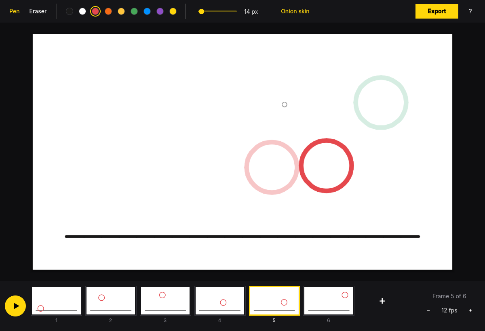

# Flip

Draw frame by frame, see the frames around the one you're on, and play it
back as an animation. Export a looping GIF or an MP4 when it moves the way
you want.



Flip follows the Omarchy theme and language live (elsewhere, the system
language), and is driven from the
keyboard. Press `?` in the app for every shortcut.

## Shortcuts

| Key | Does |
| --- | --- |
| Space | Play or pause |
| B / E | Pen / eraser |
| Right-click | Erase while drawing |
| 1 – 9 | Pick an ink (9 is the theme accent) |
| [ / ] | Smaller / bigger brush |
| O | Onion skin: the previous frame in red, the next in green |
| ← / → (or , / .) | Previous / next frame |
| Home / End | First / last frame |
| N | New frame after this one |
| D | Duplicate this frame |
| X / Delete | Delete this frame |
| Backspace | Clear this frame |
| Ctrl+← / → | Move this frame |
| − / + | Slower / faster (1–60 fps) |
| Ctrl+Z / Ctrl+Shift+Z | Undo / redo |
| Ctrl+N / Ctrl+O | New / open |
| Ctrl+S / Ctrl+Shift+S | Save / save as |
| Ctrl+E | Export GIF or MP4 |
| ? | Show or hide the shortcuts |
| Q / Ctrl+Q | Quit, asking first if there are unsaved drawings |

## Command line

Commands that need no display, for scripts and coding agents. Each exits 0 or
1, prints errors on stderr, and takes `--json`.

```sh
flip open [animation.flip]                  # the editor
flip info walk.flip                          # frames, fps, size, seconds
flip export walk.flip walk.gif [--fps 8]     # or walk.mp4
flip import walk.flip frame-*.png [--fps 12] # one frame per image
flip frames walk.flip frames/ [--paper]      # every frame as a PNG
flip skill install                           # teach your coding agents
```

## Building

Needs `qmake6`, `make`, a C++17 compiler, Qt 6 (base, declarative, Wayland),
and `ffmpeg`, all part of Omarchy.

```sh
bin/build     # build/flip
bin/test      # the Qt Test suite, offscreen
bin/install   # makepkg -fsi, so Flip shows up in the app launcher
```

## Flatpak

`bin/flatpak` builds the Flatpak (`io.github.kjlape.Flip`, on the KDE 6.11
runtime, with its own ffmpeg for exports), installs it for you, and writes
`flip.flatpak`, a single file that installs on any Linux with Flatpak:

```sh
flatpak install --user flip.flatpak
flatpak run io.github.kjlape.Flip
```

The Flatpak runs as `flatpak run io.github.kjlape.Flip <command>` for the
command-line commands. Inside its sandbox, window corners stay square (it
can't ask Hyprland for the rounding), and `skill install` can't write to
your home directory.

## File format

A `.flip` file is a Qt `QDataStream`: the magic `FLIP`, a format version,
width, height, fps, the paper color, the frame count, then each frame as a
transparent PNG. Saves are atomic.

## License

MIT. See [LICENSE](LICENSE).
